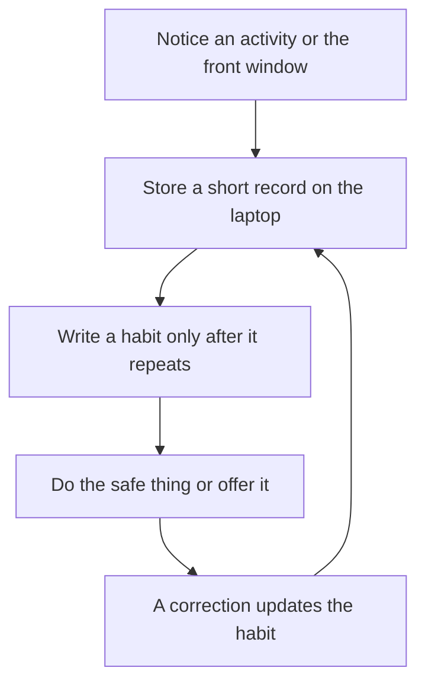

# The assistant that learns

**What you are learning here.** A personal assistant is a loop, not a single question-and-answer. It notices what happened, stores it on the laptop, waits until the pattern repeats, then makes that pattern easier. A correction is part of the loop.

A typical agent waits for an order and forgets the person. This assistant keeps a local memory of how this person uses this laptop, and tomorrow’s request can use what it learned today.

## The loop

1. **Notice.** A command, an app opening, a file, a volume or brightness change, the time of day, or a change of the front window.
2. **Store.** A short local record. One event is a note, not a habit.
3. **Habit.** The same pattern on several occasions becomes a habit. One accident does not.
4. **Help.** A safe habit can be offered, or done when the person uses a vague phrase. A risky habit still asks.
5. **Correct.** “Not that one”, “the other folder”, or doing it a different way updates the store.

## What it can see on screen

Linux keeps an accessibility tree for the front window: the app name, the window title, and the names of the visible controls. Screen readers already use this so a blind user can hear the buttons. The assistant reads that same tree.

It samples when the front window changes, and now and then while the person is active. It does not sample dozens of times a second, and it does not save a video or a screenshot archive. A list of names is small. A screen recording is large and would freeze passwords and private text into a file.

Examples of a sample:

- Chromium, window title “Shape of You - YouTube”, controls that are the search box and the video title.
- The file manager, window title showing `Pictures/Graduation`.
- A word processor, window title `Budget.docx`. The title is stored. The paragraphs inside the document are not.

When a password field is the focused control, that sample is skipped.

## What a record may contain

- The command text the person spoke or typed to the assistant.
- App name, window title, and the visible control names from the accessibility tree.
- File path, when a skill or the file manager opened a file.
- Volume, brightness, Wi-Fi, and the time of day.
- The skill that ran, and whether the person confirmed, cancelled, or corrected it.

## What stays out of memory

- Keystrokes and anything typed into a password field.
- The body of a document.
- Chat and message text.
- Screenshots and screen video.
- A copy of the record on a server. The store lives on the laptop.

Screen reading is there so the assistant can learn what the person is looking at: a YouTube list, a folder, a document name. It is not a key logger and it is not a library of their files’ contents.

## How help shows up

Memory fills in details and timing. It does not create new programs.

| Situation | What memory does |
|---|---|
| “Play some music” and evenings usually mean one song | The YouTube skill gets that song as the query |
| “Graduation photos” after the matching folder was opened before | Find-file prefers that folder |
| Brightness is lowered most evenings | Offer that level, or apply it when the phrase is “it’s too bright” |
| The person always picks the second result | Remember that preference for a similar list |
| The person says “no, the other one” | The previous choice loses, and the correction is stored |

The skill list stays fixed. If the person asks for something with no skill, the assistant says it cannot do that yet. The fallback language model may choose a skill and fill its fields. It may not invent a command line.

## When it still asks

Delete, send, pay, and turning the network off always ask, even when they match an old habit. Volume and brightness can apply immediately, and they are still logged so they can be understood later. Wi-Fi off asks, because it also cuts updates.

A suggestion is one quiet line, such as “Open your notes?”. The person can dismiss it. Dismissal is a correction, not a failure.

## The person stays in charge

A settings page lists habits as sentences. Any habit can be deleted. Learning can be paused. Pause stops new records and stops screen reading. The panel shows a small mark while screen reading is on, so the laptop never watches quietly.

The store is a local database on the ThinkPad, outside git. Deleting a habit deletes that row. There is no account to sync.

## How this stays light

The always-on piece stores short text rows. It does not keep a vision model loaded to watch the screen. The accessibility tree is already maintained by the desktop. Reading it is a small query.

Habits are simple counts and recent examples, not a second large neural net. If a later phase wants a tiny model to rank habits, that model loads on demand and has to pass the same RAM gate as everything else.

## When this gets built

Phase 2 starts the store with typed commands, files, and screen context. Phase 3 adds what was spoken. Phase 4’s understanding model may read a habit when it fills in a vague request. The rules in this file apply from the first row written.
