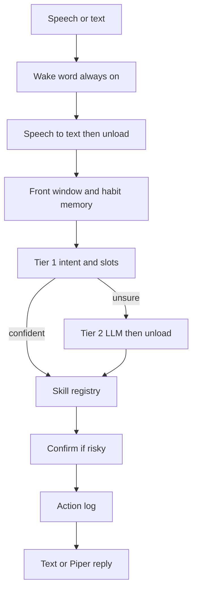
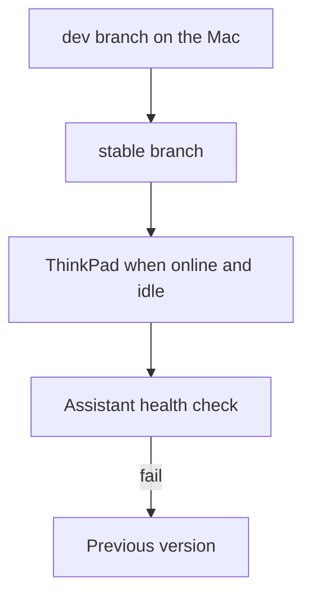

# Architecture

**What you are learning here.** Architecture is which programs exist, what each one is allowed to do, and how a sentence becomes an action without blowing the RAM budget. The pieces below match [PROJECT.md](../PROJECT.md), plus the habit memory from [03-assistant-that-learns.md](03-assistant-that-learns.md).

## Request path



Typed text enters at the same box as speech-to-text output. Habits are consulted there, before the skill runs, so a vague sentence can pick up a saved detail. The action log is also an input to future habits.

## Base system

| Piece | Choice |
|---|---|
| OS | Debian 13, minimal install, standard system utilities |
| Desktop | LXQt, core packages |
| Network | NetworkManager |
| Audio | PipeWire |
| Browser | Chromium with VA-API so video uses the integrated GPU |
| Memory pressure | zram |
| Services | Anything not needed for boot, network, audio, and the assistant stays off |

VA-API needs the driver that matches the ThinkPad’s CPU vendor, Intel or AMD. Phase 0 detects that on the machine. YouTube is opened at a watch URL after the first result is resolved. The page plays in Chromium. A separate browser-automation tool is not part of the installed system.

The idle desktop plus the always-on assistant should leave about 5GB for the person. Budgets are in [01-scope.md](01-scope.md).

## Two-tier brain

**Tier 1, always on.** A tiny model in the MiniLM or DistilBERT size range, exported to ONNX. It returns an intent, such as `play_youtube`, and slots, such as the song title. It should answer in milliseconds and cover most everyday sentences after Phase 4 trains it. Until that training exists, Phase 2 may use a small rule or embedding matcher with the same output shape, so skills do not change when the model is replaced.

**Tier 2, on demand.** A 1–2B parameter model, 4-bit, run on the CPU with llama.cpp. Candidates to measure are Qwen3 1.7B and Llama 3.2 1B. Phase 1 picks one. Tier 2 runs only when Tier 1 is not confident. It unloads after a short idle period. It returns a skill name and slots. It does not return shell.

Only one heavy model is loaded at a time: speech-to-text, then maybe Tier 2, then the spoken voice, each released before the next if that is what keeps the peak inside 1.5–2GB. Phase 1 measures the real peak.

## Voice

| Job | Tool | When it is loaded |
|---|---|---|
| Wake word | openWakeWord, custom phrase once the name exists | Always on |
| Speech-to-text | faster-whisper, English `base` int8 first | For the utterance, then it exits |
| Spoken reply | Piper | For the reply, then it exits |

A manifest maps a language tag to model files and a Piper voice. Version 1 has `en`. A later `si` entry is another row, not a rewrite. English weights do not become a Sinhala assistant by renaming the file.

## Skills

A skill is one module of ordinary code. The registry is the only list of actions. Each module publishes a name and a slot schema.

First set:

- `play_youtube(query)`
- `open_app(name)`
- `set_volume(level)`, `volume_up()`, `volume_down()`, `mute()`
- `set_brightness(level)`
- `find_file(description)`, `open_file(path)`
- `web_search(query)`
- `set_reminder(time, text)`
- `take_screenshot()`
- `wifi_on()`, `wifi_off()`

`find_file` matches names, folders, and dates. Habit memory may supply the folder that was right before. A semantic index of file contents is a later skill.

`play_youtube` resolves a video and opens Chromium. Internet is required for YouTube the site. The decision to open it is local.

Risky skills (`wifi_off`, and any future delete, send, or pay skill) go through confirmation. The others run and are logged.

## Memory

Two local stores, both outside git:

- **Action log.** Every skill call, the slots, the confirm or cancel, and whether it finished. This is how an action can be audited and, later, undone.
- **Habit store.** Repeated patterns built from the log, from settings, and from accessibility-tree samples. Rules are in [03-assistant-that-learns.md](03-assistant-that-learns.md).

The screen sampler reads the front window’s accessibility tree. It skips password fields. It writes a short description, not an image. Pause learning stops the sampler.

## Updates



Stage 1, this ThinkPad: a timer checks `stable` every 10–15 minutes when online, downloads in the background, and applies when idle. A failed health check restores the previous revision.

Stage 2, real installs: GitHub Actions on x86_64 builds signed `.deb` packages and a Debian live-build ISO. Devices use Debian’s unattended upgrades. `dev` is never what a device installs. The signing key is the trust anchor.

An update does not apply in the middle of a skill.

## Language

Every training row, model manifest entry, and user-facing string has a BCP-47 `lang` tag. Skills receive structured slots, so they do not look for English words inside a sentence. The intent model and the voice models are the language-specific parts.

## Repository map

The guide is the only folder added for this step. The rest is the target layout. Those directories are created when their phase starts.

```
/
├── PROJECT.md
├── guide/                  # this folder
├── os/
│   ├── packages.list
│   ├── config/
│   ├── live-build/
│   └── scripts/
├── assistant/
│   ├── daemon/
│   ├── skills/
│   ├── voice/
│   └── models/             # configs and manifests, never weights
├── training/
│   ├── data/
│   ├── intent_model/
│   └── eval/
├── updater/
├── docs/benchmarks/        # numbers from the ThinkPad
└── .github/workflows/
```

## Process split

The always-on process is the wake word, the Tier 1 model, the screen sampler, and the habit writer. Speech-to-text, Tier 2, and Piper are child processes that exit. Python is the language for the prototype and for training. Phase 6 may rewrite only the always-on process if the RAM numbers require it.
